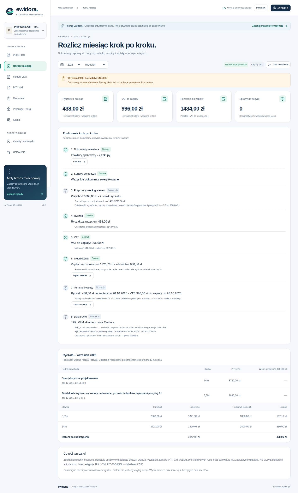
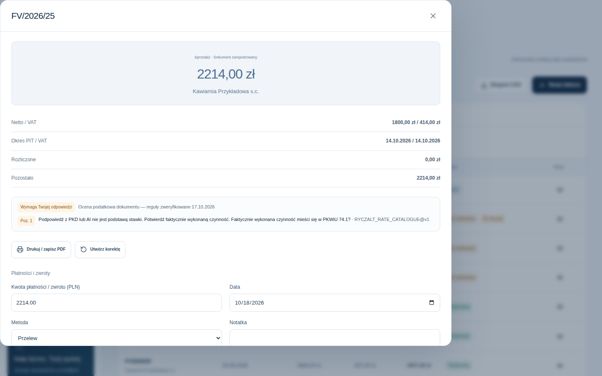
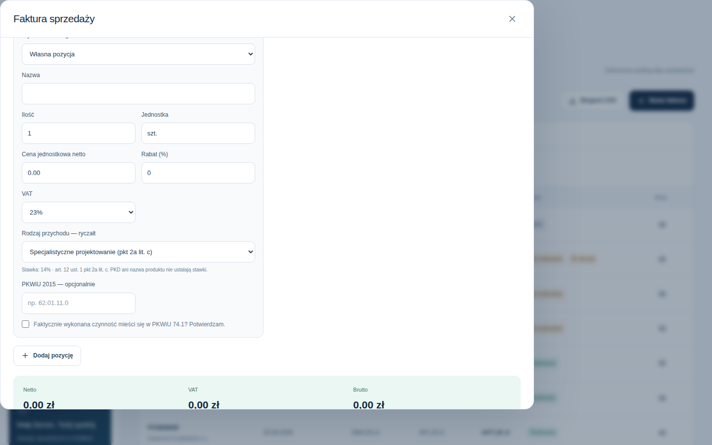
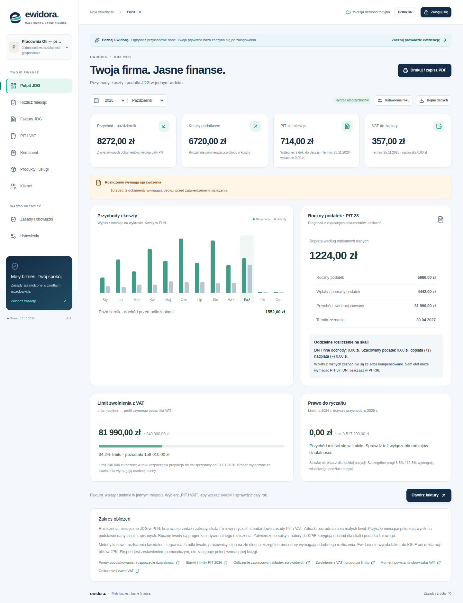
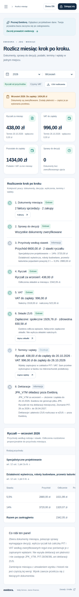

# Ewidora — mały biznes, jasne finanse

Aplikacja webowa do prowadzenia ewidencji i rozliczeń jednoosobowej działalności gospodarczej (JDG) oraz działalności nierejestrowanej w Polsce. Projekt portfolio.

**Demo:** [plsmallbusiness.vercel.app](https://plsmallbusiness.vercel.app/) — działa bez logowania, na fikcyjnych danych w pamięci przeglądarki. Domyślnie pokazuje JDG na ryczałcie; przycisk „Demo DN” przełącza na działalność nierejestrowaną.

> **Status: projekt zakończony jako portfolio (październik 2026).** Obsługiwane lata podatkowe: 2025–2026. KSeF działa wyłącznie w bezpłatnym środowisku testowym MF. Aplikacja nie jest rozwijana jako usługa komercyjna i nie zastępuje księgowego. Szczegóły w sekcji [Zakres i ograniczenia](#zakres-i-ograniczenia).



## Co potrafi

**Panel firmy JDG**
- **Rozlicz miesiąc** — jeden widok pracy nad miesiącem: dokumenty, sprawy do decyzji, przychody według stawek, ryczałt lub zaliczka PIT, VAT, wpisane składki, terminy i wpłaty, obowiązki deklaracyjne. Wykrywa szkice, luki w numeracji i możliwe duplikaty zakupów. Eksport CSV.
- **Pulpit i „PIT i VAT”** — miesięczne i roczne wyliczenia dla skali, podatku liniowego i ryczałtu, wykresy z tabelami kwot, limit zwolnienia z VAT, prawo do ryczałtu, prognoza zeznania rocznego.
- **Faktury** — sprzedaż i zakupy, wiele pozycji, rabaty, ilości ułamkowe, szkice, automatyczna numeracja, korekty jako osobne dokumenty, płatności z odwróceniami, załączniki, wydruk do PDF. Wystawiony dokument jest niezmienny.
- **Remanent KPiR** — spisy z natury z wyceną, poprawkami i wpływem na dochód.
- **Katalog produktów i usług**, klienci, kopia danych JSON z importem.

**Ryczałt wielostawkowy** — pozycja faktury ma rodzaj przychodu z art. 12 ust. 1 ustawy o ryczałcie (55 pozycji, stawki 2–17%, symbole PKWiU 2015), a stawka wynika z tego wyboru. Kilka stawek w jednej firmie i na jednej fakturze, próg 8,5% / 12,5% ponad 100 000 zł dla przychodów z pkt 4, proporcjonalny podział odliczeń (art. 11 ust. 3), przenoszenie korekt na kolejne okresy (art. 6 ust. 1e). Stawka VAT jest osobnym polem.

**Ocena dokumentów** — każdy dokument dostaje status: zweryfikowany, wymaga odpowiedzi, wymaga specjalisty albo błędny. Aplikacja zadaje pytania tam, gdzie z faktury nie da się ustalić ujęcia: środek trwały, samochód i paliwo, użytek prywatny, reprezentacja, okres korekty, odrębność świadczeń. Podpowiedź z PKD lub AI nigdy nie wystarcza do ustalenia stawki.

**Działalność nierejestrowana** — ewidencja należności i wpłat, kasowy PIT-36, limity 2025 (miesięczne) i 2026 (kwartalne), przejście DN → JDG z zachowaniem historii.

**Laboratorium KSeF TEST** — pełny obieg w środowisku testowym Ministerstwa Finansów: podpis XAdES, faktura FA(3) walidowana oficjalnym XSD, szyfrowanie, wysyłka, numer KSeF i UPO. Dostępne dla kont z administracyjnym przydziałem; dane są fikcyjne i nie trafiają do księgowości.

| | |
| --- | --- |
|  |  |
|  |  |

## Rozwiązania, które warto zobaczyć

- **Wersjonowany rejestr reguł podatkowych** ([lib/tax-rules.ts](lib/tax-rules.ts)) — każda stawka i limit ma podstawę prawną, okres obowiązywania, wersję i powiązane testy. Dla daty spoza sprawdzonych okresów obliczenie kończy się błędem „nieobsługiwane”, zamiast użyć bieżących wartości.
- **Pieniądze w groszach i arytmetyka całkowitoliczbowa** — kwoty jako liczby całkowite, iloczyny w `BigInt`, zaokrąglenia do pełnych złotych według art. 63 Ordynacji podatkowej. Połowa składki zdrowotnej liczona w jednostkach pół grosza.
- **Silnik ryczałtu** ([lib/lump-sum.ts](lib/lump-sum.ts)) i **rozliczenie miesiąca** ([lib/month-settlement.ts](lib/month-settlement.ts)) jako czyste funkcje — ten sam wynik trafia na ekran, do eksportu i do testów.
- **Bezpieczeństwo danych** — Supabase Auth, RLS na każdej tabeli, jawne uprawnienia (bez DELETE, płatności tylko dopisywane), brak klucza service-role po stronie aplikacji, cookies HttpOnly, kontrola Origin zapisów.
- **Niezmienność i idempotencja** — wyzwalacze PostgreSQL blokują zmianę wystawionych dokumentów, korekty są osobnymi rekordami, każda operacja ma identyfikator chroniący przed podwójnym zapisem, szkice mają wersje na wypadek pracy z dwóch urządzeń.
- **KSeF bez przechowywania sekretów** — klucze, certyfikat i tokeny istnieją tylko w pamięci jednego żądania; utrwalony etap przed wysyłką chroni przed powtórzeniem faktury po utracie odpowiedzi.
- **Demo bez zaplecza** — bez konfiguracji Supabase aplikacja działa w trybie demonstracyjnym na spójnych danych fikcyjnej firmy ([lib/demo-jdg.ts](lib/demo-jdg.ts)).

## Architektura

| Warstwa | Technologia |
| --- | --- |
| Interfejs i API | Next.js 16 (App Router), React 19, TypeScript, Tailwind CSS 4 |
| Dane i logowanie | Supabase: PostgreSQL z RLS, Auth, prywatny bucket plików |
| Walidacja | Zod po stronie aplikacji, powtórzona w wyzwalaczach PostgreSQL |
| KSeF TEST | xadesjs, @peculiar/x509, xmllint-wasm (walidacja XSD), WebCrypto |
| Wdrożenie | Vercel (Node.js 24), GitHub Actions |

Struktura: `app/` — widoki i trasy API, `lib/` — logika domenowa i podatkowa, `supabase/migrations/` — 9 migracji, `tests/` — testy jednostkowe i bazodanowe, `docs/` — plany, audyt i stan prac.

## Testy

136 testów `node:test`: dokładne kwoty i zaokrąglenia, progi skali i ryczałtu, 15 scenariuszy ryczałtu wielostawkowego z ręcznie wyprowadzonymi wartościami, ocena dokumentów, rozliczenie miesiąca, VAT do przeniesienia, remanent, import, izolacja dwóch kont i uprawnienia w PostgreSQL (PGlite), protokół KSeF (podpis, szyfrowanie, XSD, utrata odpowiedzi).

```sh
pnpm install --frozen-lockfile
pnpm typecheck && pnpm test && pnpm build
```

GitHub Actions uruchamia te same kroki dla każdego PR. Commit z dopiskiem `[screenshots]` na gałęzi `feature/**` buduje demo i odświeża zrzuty ekranu (`scripts/screenshots.mjs`).

## Uruchomienie lokalne

```sh
pnpm install
pnpm dev            # bez zmiennych środowiskowych: tryb demonstracyjny
```

Do pracy z własną bazą ustaw w `.env.local` wartości z `.env.example` i zastosuj migracje z `supabase/migrations/` w nowym projekcie Supabase.

## Zakres i ograniczenia

- Lata podatkowe 2025–2026, krajowe transakcje w PLN, rozliczenia miesięczne. Od 2027 r. aplikacja wymagałaby nowych reguł i zmian w bazie — plan jest opisany w [PLAN-2027.md](docs/PLAN-2027.md), ale nie będzie realizowany.
- KSeF tylko w środowisku testowym MF; faktury z ewidencji nie są wysyłane do produkcyjnego KSeF.
- Składki ZUS są wpisywane jako zapłacone kwoty — aplikacja nie wylicza składek należnych. Nie generuje JPK_V7, JPK_EWP/PKPIR, PIT-28/36/36L ani deklaracji ZUS.
- Brak środków trwałych, rozliczeń kwartalnych, metod kasowych, transakcji zagranicznych i kadr. Pełna lista: [JDG_COVERAGE_MATRIX.md](docs/JDG_COVERAGE_MATRIX.md).
- Odpowiedzi na pytania oceny zapisuje się przed wystawieniem dokumentu; miesiąca nie zamyka się z utrwaleniem wyniku.
- Wyniki są pomocnicze. Reguły sprawdzono w źródłach urzędowych 16–17.10.2026.

## Dokumentacja

- [Podsumowanie projektu](docs/PROJECT_SUMMARY.md)
- [Audyt i analiza luk](docs/ACCOUNTING_GAP_ANALYSIS.md) · [Macierz pokrycia JDG](docs/JDG_COVERAGE_MATRIX.md) · [Stan wdrożenia](docs/ACCOUNTING_IMPLEMENTATION_STATUS.md)
- [Plan JDG](docs/PLAN-JDG.md) · [Laboratorium KSeF TEST](docs/PLAN-KSEF-TEST.md) · [Wdrożenie](docs/WDROZENIE.md) · [Historia prac](docs/STATUS.md) · [Marka](docs/BRAND.md)

## Pochodzenie

Implementacja własna. Inspiracje funkcjonalne: hipek/sales-registry, patimio66/mojmalybiznes i Pawel-04/Projekt_AI — bez włączania ich kodu.
